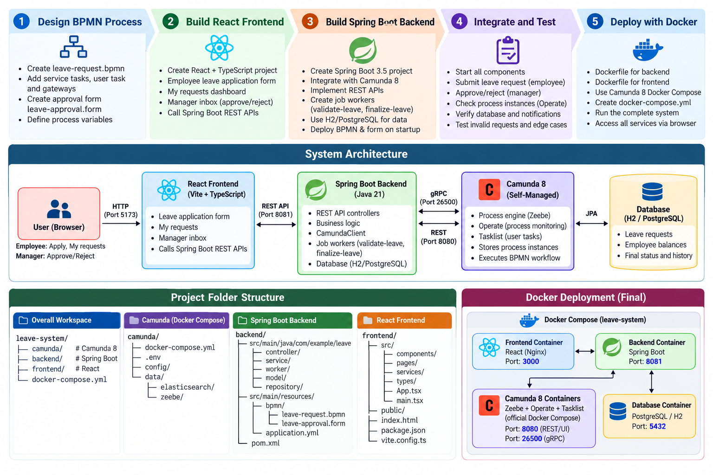
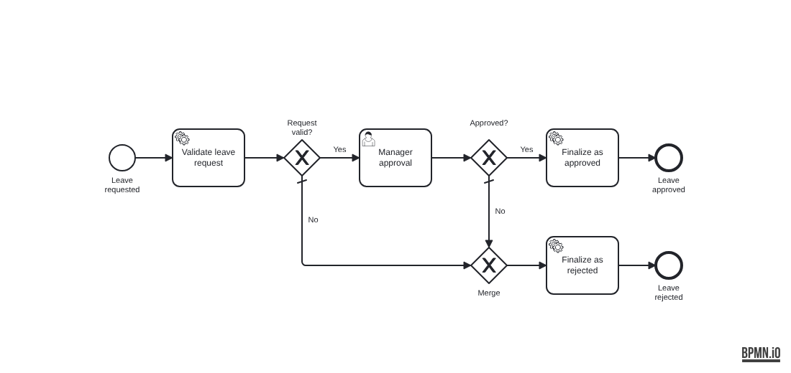

# Leave Application System

An employee leave portal with **Camunda 8** (workflow engine), a **Spring Boot** backend and a **React** frontend. Everything runs with **one Docker command**.

- **Employee**: applies for leave and tracks the status of each request.
- **Spring Boot**: saves the request and starts the BPMN process. Its job workers validate the request and finalise it.
- **Manager**: approves or rejects the request in the Manager Inbox (or in Camunda Tasklist).
- **Camunda Operate**: shows every process instance and the path it took.



---

## Run it (Docker)

### What you need

- **Docker Desktop**, running. On Windows it uses the WSL 2 backend.
- About **4 GB of free memory**.
- These ports must be free: `3000`, `8080`, `8081`, `26500`, `9600`, `5432`.
  If you have Camunda 8 Run (c8run) or PostgreSQL running locally, stop them first.

You do **not** need Java, Maven or Node.js installed. Docker builds everything.

### Start

```bash
git clone https://github.com/<your-github-user>/<this-repo>.git
cd <this-repo>
docker compose up -d --build
```

The first start downloads the images and builds the app, which takes about 5 to 10 minutes. Later starts take under a minute.

Check that everything is up:

```bash
docker compose ps
```

`orchestration` should show `healthy`, and `backend`, `frontend` and `postgres` should show `running`.
In the first minute the backend can restart once while Camunda finishes starting. That is expected.

### Open

| What | URL | Login |
|---|---|---|
| **Leave Portal (React)** | http://localhost:3000 | none |
| Camunda Operate | http://localhost:8080/operate | `demo` / `demo` |
| Camunda Tasklist | http://localhost:8080/tasklist | `demo` / `demo` |
| Backend API | http://localhost:8081/api/leaves/pending | none |

### Stop

```bash
docker compose down        # stop, keep data
docker compose down -v     # stop and delete all data (fresh start)
```

---

## Try the workflow

1. Open http://localhost:3000 and enter a name and email at the top.
2. **Apply**: choose Annual leave, pick three weekdays, and submit. You are taken to **My requests**.
3. The status moves from `SUBMITTED` to `PENDING APPROVAL` within a second or two, after the validation worker runs.
4. **Manager inbox**: add a comment and click **Approve**.
5. **My requests**: the status becomes `APPROVED`, and annual leave remaining drops from 20 to 17.
6. **Operate** (http://localhost:8080/operate): open *Leave request* and the instance to see the path taken and its variables.

Other cases to test:

| Test | What to do | Expected result |
|---|---|---|
| Manager rejection | Submit a request, click **Reject** | `REJECTED`, balance unchanged |
| Not enough balance | Ask for more annual days than remaining | Rejected by validation, never reaches the manager |
| Weekend only | Saturday to Sunday | Rejected: no working days |
| Tasklist approval | Submit, then in Tasklist assign the *Manager approval* task to yourself, tick *Approve*, and complete it | `APPROVED` |

---

## How it works



| BPMN element | Type | Implemented by |
|---|---|---|
| Validate leave request | Service task, `validate-leave` | `LeaveWorkers.validate` checks dates, working days and annual balance |
| Request valid? | Exclusive gateway | `=valid`; the default flow is the rejection path |
| Manager approval | Camunda user task, form `leave-approval` | Manager Inbox, through `POST /api/leaves/{id}/decision`, or Tasklist |
| Approved? | Exclusive gateway | `=approved`; the default flow is the rejection path |
| Finalize as approved / rejected | Service task, `finalize-leave`, input `outcome` | `LeaveWorkers.finalizeLeave` saves the final status and deducts the balance |

Process variables: `requestId`, `employeeEmail`, `leaveType`, `days`, `startDate`, `endDate` (set at start), `valid` and `validationMessage` (from validation), `approved` and `managerComment` (from the manager), and `outcome` (input mapping on each finalize task).

The browser only talks to Spring Boot. Spring Boot talks to Camunda over gRPC (port 26500) and REST (port 8080).

### REST API

| Method and path | Purpose |
|---|---|
| `POST /api/leaves` | Submit a leave request |
| `GET /api/leaves?employeeEmail=...` | List one employee's requests |
| `GET /api/leaves/pending` | List requests waiting for a manager |
| `GET /api/leaves/balance?employeeEmail=...` | Read the remaining annual leave (20 days by default) |
| `POST /api/leaves/{id}/decision` | Approve or reject, with body `{ "approved": true, "comment": "..." }` |

---

## Project structure

```
leave-system/
├── docker-compose.yml          # Full stack: Camunda + PostgreSQL + backend + frontend
├── camunda/
│   ├── docker-compose.yml      # Camunda only (development mode)
│   └── application.yaml        # Camunda 8.10 settings (demo/demo, unprotected API)
├── backend/                    # Spring Boot 3.5, Java 21, Camunda 8.10 starter
│   ├── Dockerfile
│   ├── pom.xml
│   └── src/main/
│       ├── java/com/example/leave/
│       │   ├── controller/     # LeaveController (REST API)
│       │   ├── service/        # LeaveService, NotificationService
│       │   ├── worker/         # validate-leave and finalize-leave job workers
│       │   ├── model/          # Entities and request bodies
│       │   └── repository/     # Spring Data JPA repositories
│       └── resources/
│           ├── application.yml
│           └── bpmn/
│               ├── leave-request.bpmn
│               └── leave-approval.form
├── frontend/                   # React + TypeScript (Vite), served by Nginx in Docker
│   ├── Dockerfile
│   ├── nginx.conf
│   └── src/
│       ├── components/  pages/  services/  types/
│       ├── App.tsx
│       └── main.tsx
└── docs/
```

Open `backend/src/main/resources/bpmn/leave-request.bpmn` and `leave-approval.form` in **Camunda Desktop Modeler** to view or edit the process.

---

## Development mode (without Docker for the app)

Use this mode while changing code. You need Java 21, Maven 3.9 or newer, Node.js 20 or newer, and Docker Desktop (Camunda still runs in Docker).

```bash
# Terminal 1: Camunda only
cd camunda
docker compose up -d

# Terminal 2: backend on port 8081 (uses an H2 file database in backend/data/)
cd backend
mvn spring-boot:run

# Terminal 3: frontend on port 5173 (Vite forwards /api to port 8081)
cd frontend
npm install
npm run dev
```

Open http://localhost:5173. The H2 console is at http://localhost:8081/h2-console, with JDBC URL `jdbc:h2:file:./data/leavedb`, user `sa` and an empty password.

Stop the full stack (`docker compose down` in the root folder) before starting development mode. Both use port 8080.

---

## Troubleshooting

| Problem | Fix |
|---|---|
| `port is already allocated` | Another program uses that port. Stop c8run, a local PostgreSQL, or anything else on that port. |
| Backend keeps restarting | Run `docker compose logs -f backend`. In the first minute this is normal while Camunda starts. |
| Portal shows "Cannot reach the backend" | The backend is still starting. Wait about 30 seconds and refresh. |
| Approve shows a 409 message | The approval task was not visible in Camunda's search yet. The app retries for you; if it persists, check Operate for an incident. |
| A request stays `SUBMITTED` | Open the instance in Operate and look for an incident, then check `docker compose logs backend`. |
| Want a clean start | `docker compose down -v`, then `docker compose up -d --build` |

---

## Versions

Camunda 8.10.9 (`camunda/camunda` image and `camunda-spring-boot-3-starter`), Spring Boot 3.5.16, Java 21, PostgreSQL 16, React 19 and Vite 8.

The Camunda image version in `docker-compose.yml` and `camunda.version` in `backend/pom.xml` must stay the same.

## Note

This is a learning project. It has **no login or role checks**, so anyone who can open the portal can act as the manager. Do not expose it to the internet.
